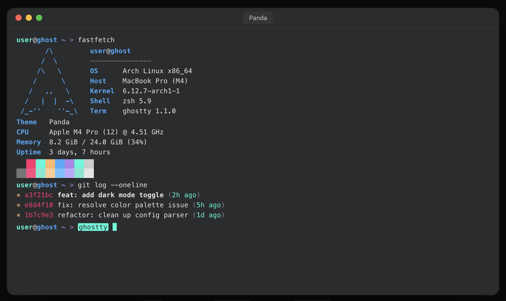

# Panda

A dark, superminimal theme based on the [Panda VS Code theme](https://github.com/PandaTheme/panda-syntax-vscode).

[](https://github.com/PandaTheme) [](https://ghostty-style.vercel.app/config/panda)



<p align="center"><sup>Screenshot taken from <a href="https://ghostty-style.vercel.app/config/panda">ghostty.style</a>.</sup></p>

## Getting Started

1. Create a `themes` folder for ghostty (if it does not exist).

    ```bash
    mkdir -p ~/.config/ghostty/themes
    ```

2. Download and save the theme config.

    ```bash
    curl -sfL "https://raw.githubusercontent.com/beta/ghostty-theme-panda/refs/heads/main/panda" > ~/.config/ghostty/themes/panda
    ```

3. Add the following line to ghostty config file.

    ```
    theme = "panda"
    ```

4. Reload config (<kbd>⌘</kbd> + <kbd>shift</kbd> + <kbd>,</kbd>) or restart ghostty to take effect.
